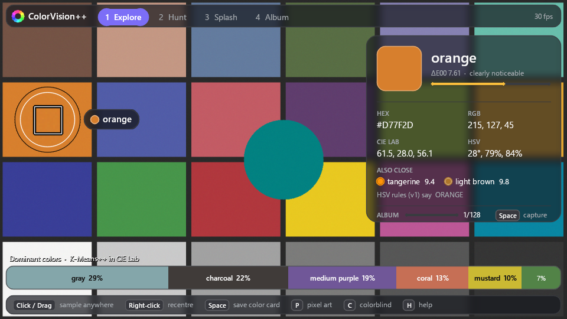
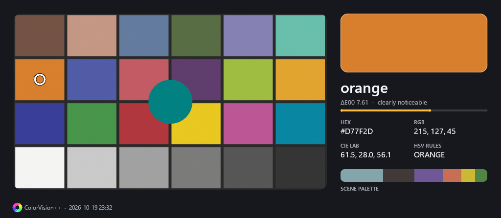
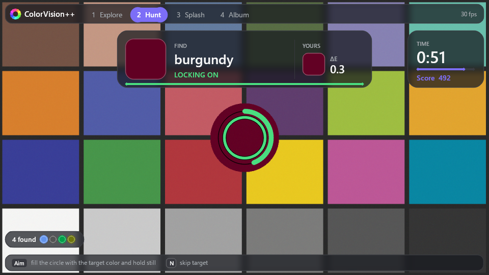
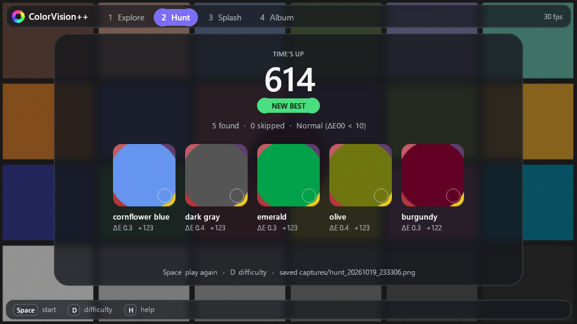
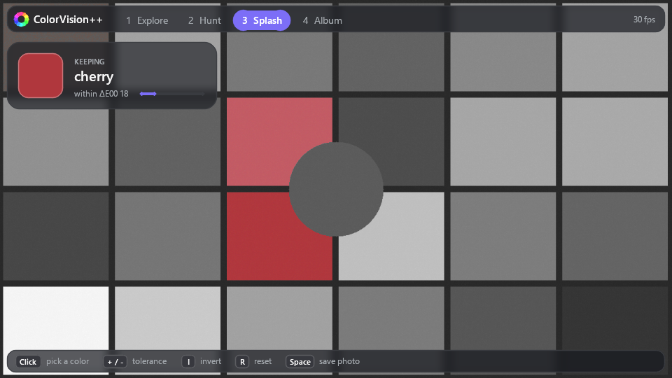
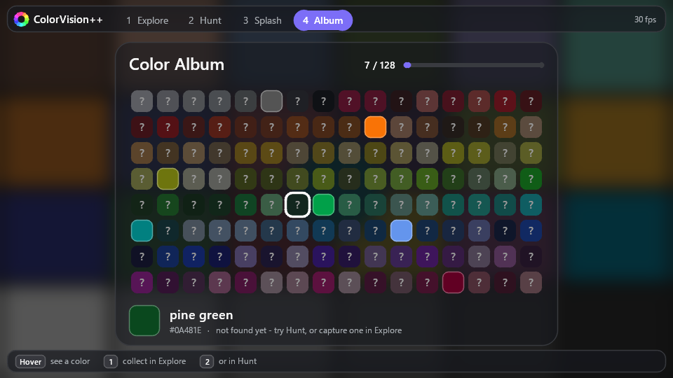
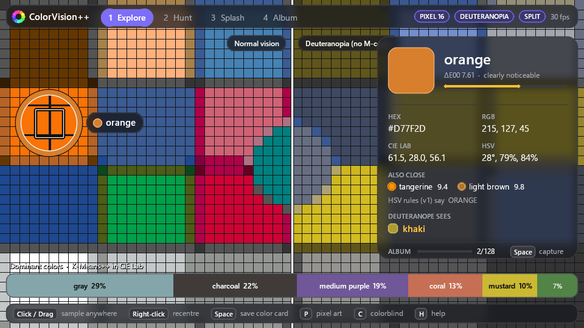

# ColorVision++ — Perceptual Color Analysis Engine

A real-time color detection and naming system in C++17 + OpenCV, built on
**CIE L\*a\*b\* colorimetry**, the **CIEDE2000 perceptual distance metric** (Sharma et al. 2005),
**K-Means++ dominant color extraction** in Lab space and **colorblindness simulation**
(Machado et al. 2009) — wrapped in an interactive camera app where ΔE2000 names what you point
at, judges a color-hunting game, and fills a collectible color album.

It started as a high-school RGB → HSV color detector; that original rule-based classifier is
still here as the baseline the perceptual engine is benchmarked against.



---

## The camera app (`color_camera`)

Four modes, switched with `1`–`4`, `Tab`, or by clicking the tabs.

### Explore — what color is that?
A color dropper with a magnifier loupe. Click or drag anywhere to sample (right-click goes back
to the centre). The card shows the ΔE2000 name with a match-quality bar, the runner-up names,
HEX / RGB / CIE Lab / HSV, what the original HSV rules would have said, and a live strip of the
scene's dominant colors. `Space` saves a **color card** and, if the match is close (ΔE00 < 10),
adds the color to your album.



### Hunt — find it in the real world
A 60-second game: the app names a target color and you show the camera a real object that
matches it. A hot/cold meter follows the ΔE2000 distance; stay inside the level's threshold
(Easy 15 / Normal 10 / Hard 6) for 0.6 s to lock it in. Points reward precision and speed, the
best score per level is kept, and each round ends with a result card saved to disk.

 

### Splash — keep one color
Click a color to keep it; everything farther than the ΔE2000 tolerance turns grey
(`+`/`-` or the mouse wheel to adjust, `I` to invert and remove that color instead).
`Space` saves the photo.

### Album — collect them all
Every named color you have found, sorted by hue, with undiscovered ones hinted behind a `?`.

 

### View filters (any mode)
- **Pixel art** (`P`): each block is averaged and repainted with its nearest named color — the
  scene redrawn with the classifier's 129-color vocabulary.
- **Colorblind simulation** (`C`: protanopia / deuteranopia / tritanopia) with a **split screen**
  (`V`). Explore also tells you what a colorblind viewer would call the sampled color.



### Controls

| Key | Action |
|---|---|
| `1`–`4`, `Tab`, click a tab | Switch mode |
| Click / drag, right-click | Sample a point (Explore) or pick a color (Splash); recentre / reset |
| `Space` | Explore: save color card · Hunt: start · Splash: save photo |
| `N` / `D` | Hunt: skip target / change difficulty |
| `P`, `+` / `-`, wheel | Pixel art on/off, block size (tolerance in Splash) |
| `C` / `V` | Cycle colorblind simulation / split screen |
| `I` / `R` | Splash: invert / reset |
| `F` / `M` | Freeze frame / mirror |
| `H` / `Esc` | Help overlay / quit |

`color_camera photo.jpg` explores a still image; `color_camera --camera 1` picks another webcam.
Cards, photos and progress go to `./captures/`.

*Screenshots are rendered from a synthetic ColorChecker scene.*

---

## Benchmark Results

| Metric | HSV baseline | ΔE2000 nearest-neighbor |
|---|---|---|
| Broad-category accuracy (11 classes) | 64% | **84%** (+20 pp) |
| Mean ΔE2000 perceptual error | 9.33 | **5.63** (40% lower) |
| Throughput | 11M cls/sec | 26K cls/sec |

Dataset: 129 named colors sampled from the XKCD Color Survey (Monroe 2010), 80/20 train/test split.
Throughput depends on the machine.

---

## Engine

### 1. CIE L\*a\*b\* Colorimetry Pipeline
- sRGB → CIE XYZ (D65 illuminant, IEC 61966-2-1 linearization)
- CIE XYZ → CIE L\*a\*b\* (piecewise cube-root transfer function, D65 white point)
- Full implementation from primary standards — not a library wrapper

### 2. CIEDE2000 Perceptual Color Difference
- Complete implementation of Sharma et al. (2005) including:
  - G-factor chroma adjustment for the blue-purple region
  - Hue-angle quadrant correction
  - Parametric weighting functions S_L, S_C, S_H
  - R_T rotation term (blue-purple anomaly correction)
- Used for color naming, dominant-color labeling, Hunt scoring and the Splash mask
- `NamedColorCache` memoises nearest-name search on a 64³ RGB grid for per-block naming
  (pixel art); Splash tabulates ΔE2000 to the chosen color over the same grid once per click,
  so per-pixel work is a table read

### 3. K-Means++ Dominant Color Extraction
- Custom K-Means++ implementation (not `cv::kmeans`) with D² seeding
- Clustering in Lab space: perceptually uniform, substantially better than Euclidean RGB
- ΔE2000 applied post-clustering to name each centroid (K calls per frame, not per-pixel)
- **Temporally coherent for video**: `DominantColorTracker` warm-starts Lloyd iterations from
  the previous frame's centroids (no flicker or reordering, a few iterations per frame),
  re-seeds empty clusters on the worst-fitted pixel, and EMA-smooths each cluster's share
- Also powers the web palette extractor (`color_cli --palette`)

### 4. Colorblindness Simulation
- Three clinical types: Protanopia, Deuteranopia, Tritanopia
- Simulation matrices from Machado et al. (2009, severity 1.0)
- **Correct pipeline**: gamma-decode → matrix → gamma-encode (naive implementations skip this)
- Both transfer curves are tabulated (no per-pixel `pow`) and rows run in parallel; output stays
  within ±1 code value of the exact pipeline

### 5. Quantitative Benchmark (`color_bench`)
- Evaluates both classifiers on identical 11-class task (fair comparison)
- Reports: category accuracy, mean ΔE2000 error, throughput
- Reproducible: deterministic 80/20 split, fixed RNG seed

---

## Build

```bash
cmake -S . -B build -DCMAKE_BUILD_TYPE=Release
cmake --build build -j
```

Requires a C++17 compiler, CMake ≥ 3.10 and OpenCV ≥ 4. Build in **Release** — a Debug build is
several times slower and the camera app will stutter.

On Windows, MSYS2 works well: `pacman -S mingw-w64-x86_64-{gcc,cmake,ninja,opencv}`, then run
the commands above from a shell with `C:\msys64\mingw64\bin` on `PATH`.

The overlay uses FreeType with a system UI font when OpenCV includes the `freetype` contrib module
(MSYS2, Homebrew and Debian/Ubuntu packages do); otherwise it falls back to OpenCV's built-in
fonts. Set `COLORVISION_FONT` / `COLORVISION_FONT_BOLD` to use a specific `.ttf`.

---

## Usage

```bash
./build/color_camera                        # Interactive camera app (press H for controls)
./build/color_bench                         # Run quantitative benchmark
./build/color_cli                           # Interactive CLI: RGB or HEX input → Lab + ΔE2000
./build/color_cli --json 58 134 255         # One color as JSON
./build/color_cli --palette photo.jpg 6     # Dominant colors of an image as JSON
python web/app.py                           # Web UI on http://localhost:5000 (needs Flask)
```

---

## Architecture

```
include/
  ColorDetector.h      Original HSV classifier (baseline)
  ColorScience.h       sRGB→XYZ→Lab, ΔE2000, named color palette, cached naming
  DominantColors.h     K-Means++ dominant colors + temporally coherent tracker
  ColorblindFilter.h   Colorblindness simulation
  CameraApp.h          Camera app: modes, input, rendering (independent of frame source)
  ColorHunt.h          Color Hunt game logic
  Progress.h           Album + best scores, persisted to captures/progress.txt
  Hud.h                Overlay drawing: text, frosted-glass cards, rounded shapes
src/
  ColorDetector.cpp    HSV rule-based classifier
  ColorScience.cpp     CIE colorimetry + CIEDE2000 + XKCD palette
  DominantColors.cpp   K-Means++ in Lab space
  ColorblindFilter.cpp Gamma-correct simulation with lookup tables
  CameraApp.cpp        Modes, input handling, rendering
  ColorHunt.cpp        Targets, lock-on and scoring
  Progress.cpp         Save file
  Hud.cpp              Drawing toolkit
  Benchmark.cpp        Evaluation framework (color_bench)
  main.cpp             CLI application
  realtime.cpp         Webcam/window wiring for CameraApp
web/
  app.py               Flask wrapper around color_cli
```

---

## References

1. Sharma, G., Wu, W., & Dalal, E. N. (2005). The CIEDE2000 Color-Difference Formula.
   *Color Research & Application*, 30(1), 21–30.

2. Machado, G. M., Oliveira, M. M., & Fernandes, L. A. F. (2009). A Physiologically-based
   Model for Simulation of Color Vision Deficiency.
   *IEEE Transactions on Visualization and Computer Graphics*, 15(6), 1291–1298.

3. Arthur, D. & Vassilvitskii, S. (2007). k-means++: The Advantages of Careful Seeding.
   *SODA 2007*, 1027–1035.

4. Monroe, R. (2010). XKCD Color Survey. https://blog.xkcd.com/2010/05/03/color-survey-results/

5. IEC 61966-2-1:1999. Multimedia systems and equipment — Colour measurement and management.
